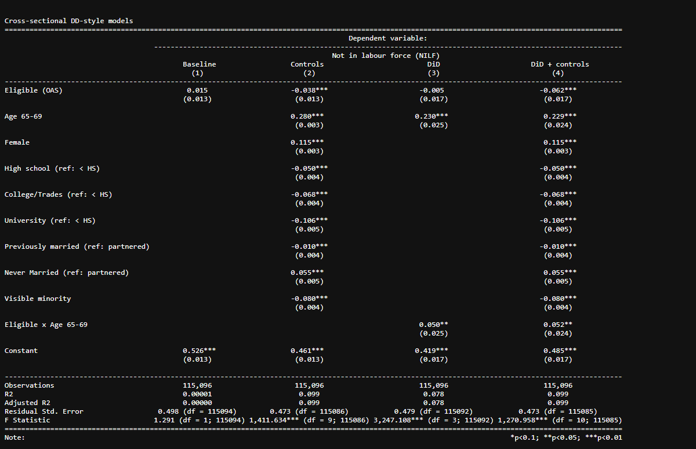

# The-Causal-Effect-of-Old-Age-Security-on-Labor-Force-Exit-

An empirical causal inference project evaluating whether Old Age Security (OAS) eligibility accelerates retirement behavior in Canada, utilizing a cross-sectional Difference-in-Differences (DiD) design on the 2021 Statistics Canada Census Public Use Microdata File (PUMF).

---

## Summary

* **Research Question:** What is the causal effect of OAS eligibility at age 65 on the probability of exiting the labour force for older adults in Canada?
* **Identification Strategy:** Exploits a natural experiment comparing individuals across the age-65 eligibility threshold against Canada's **10-year residency requirement**, comparing eligible residents to recently arrived immigrants who do not meet the residency rule.
* **Core Finding:** OAS pension eligibility induces a statistically significant **+5.2 percentage point increase** (p = 0.034) in the probability of labor force exit, distinct from the **+22.9 percentage point increase** driven by natural aging transitions.
* **Sample Size:** N = 115,096 individuals aged 60–69 from the 2021 Canadian Census.

---

## Identification Strategy & Empirical Model

Because legal entitlement to OAS requires both reaching **age 65** and satisfying a **10-year Canadian residency rule**, this paper estimates a cross-sectional Difference-in-Differences model:

**NILF***i* = α + β₁ **eligible***i* + β₂ **agegrp** + δ(**eligible** × **agegrp**) + τ**X***i* + ε*i*

### Variables
* **Dependent Variable (NILF_i):** Binary indicator equal to 1 if the individual is Not in the Labour Force (retired / not seeking work) and 0 if employed or actively seeking work. 
* **Eligible:** Binary indicator equal to 1 for individuals meeting legal residency criteria (Canadian-born or arrived in 2011 or earlier), and 0 for recent immigrants arrived after 2011.
* **Agegrp:** Binary indicator for age cohort (0 for ages 60–64; 1 for ages 65–69).
* **δ (Parameter of Interest):** The interaction term (eligible × agegrp) capturing the causal impact of OAS pension eligibility on labor force exit.
* **X_i (Demographic Controls):** Education level, marital status, gender, and visible minority status.

### Addressing Selection Bias (Conditional Parallel Trends)
A two-sample Welch t-test on visible minority status across eligibility status reveals significant baseline demographic imbalance (t = 68.46, p < 0.001). Recent immigrants differ systematically from established residents in lifetime domestic earnings and wealth accumulation. By controlling for education, marital status, gender, and visible minority status, the model controls for selection on observables to satisfy conditional parallel trends.

---

## Key Results

* **Aging Effect:** Entering the 65–69 age bracket increases the likelihood of leaving the workforce by **22.9 percentage points**, holding all demographic traits constant.
* **OAS Policy Distortion:** Qualifying for OAS produces an additional **5.2 percentage point** increase in labor force exit, illustrating that non-labor income liquidity significantly accelerates retirement decisions.
